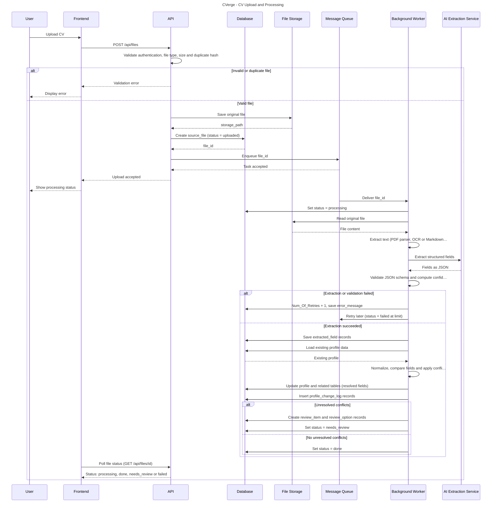

# CVerge (Multi-Source Resume Parsin & Data-Enrichment Sync)

> *CVerge — Many sources. One profile.* (logo)

**Project Team Members:**

- Sahar Fayyad
- Jenan Yaseen
- Basheer Daoud
- Nada Khairaldin
- Eman Ishtawi
- Ahmad Al-imrani

---

## I. Content

- I. Content
- II. Introduction
- III. Requirements
  - 1. Functional requirements
    - 1.1 L:ogin, access and profile
    - 1.2 Sending sources
    - 1.3 Reading text
    - 1.4 Field extraction (LLM)
    - 1.5 Cleaning and conflict resolution
    - 1.6 Source tracking and history
    - 1.7 Saving the profile
    - 1.8 Human review and settings
    - 1.9 Administrator dashboard
  - 2. Non-functional requirements
    - 2.1 Performance
    - 2.2 Scalability and capacity
    - 2.3 Availability and reliability
    - 2.4 Security
    - 2.5 Privacy and compliance
    - 2.6 Data integrity, auditability and traceability
    - 2.7 Extraction quality and fairness
    - 2.8 Usability, accessibility and localization
    - 2.9 Maintainability, observability and operations
    - 2.10 Roles
    - 2.11 Key terms
- IV. Sequence digram
- V. Entity Relationship Diagram (ERD)
- VI. Wirefram Link
- VII. GitHup Repo Link

---

## II. Introduction

Candidate information is rarely stored in one place. A single job seeker may have a PDF resume, a LinkedIn Markdown export, a Word document, and a structured assessment result, and these sources often contain incomplete, outdated, duplicated, or conflicting information. Differences in layout, formatting, date style, and naming make accurate extraction harder still, and a profile built from poorly parsed data can leave a qualified candidate effectively invisible to recruiters.

CVerge consolidates candidate information from these sources into one unified professional profile that follows a predefined internal data schema. The system stores every uploaded file unchanged and extracts its text, using Optical Character Recognition (OCR) when a document is scanned. It then converts the text into structured fields and validates and normalizes the values, such as dates and skill names. When sources disagree, CVerge applies predefined, deterministic business rules, for example preferring the newer source or preferring a verified result over a self-reported one, so that information is merged consistently.

When a conflict cannot be resolved by these rules, or a value has low confidence, CVerge keeps all the conflicting values together with their sources and sends the affected field to a human reviewer. The reviewer examines the source evidence and records a decision. For every field, the system keeps its source, its confidence, and the rule that selected it, along with a history of profile changes and review decisions, so that each value can be explained.

The system has three roles. The job seeker creates an account, uploads supported documents, and maintains a unified profile. The reviewer resolves flagged conflicts. The administrator has all reviewer abilities and also monitors processing through a dashboard, retries failed files, and manages users and the skill and alias lists.

The project scope covers document upload and retention, text extraction, structured data validation, normalization, deterministic conflict resolution, human review of unresolved conflicts, asynchronous processing, error handling, and profile change tracking. The solution will be evaluated using representative test documents. Because automated extraction cannot be perfectly accurate, CVerge is designed to flag uncertain cases for human review rather than guess.

---

## III. Requirements

### 1. Functional requirements

#### 1.1 L:ogin, access and profile

| ID | Requirement | Expected outcome | Priority |
|---|---|---|---|
| FR-001 | A person can register a Candidate account with name, email and password. | Account created with role Candidate; duplicate email or weak password rejected. | Must |
| FR-002 | Registered users log in with email and password. | Valid credentials enter the system; wrong details rejected. | Must |
| FR-003 | Each function is allowed only for the right role. | Candidate sees only own data; only Admin uses vetting, settings, re-runs, dashboard; only Reviewer uses the review queue. | Must |
| FR-004 | A logged-in Candidate views their own unified profile: personal info (name, email, phone, city, country), title, summary, experience, education, skills, certifications, projects, languages, links (LinkedIn, GitHub, portfolio, website, other). | Candidate sees their current live profile and no one else's. | Must |
| FR-068 | Register or log in with Google or LinkedIn. Social login creates Candidate accounts only; Admin and Reviewer use email and password. | New person gets an account and profile on first login; returning person enters directly; failed or cancelled login shows a message. | Should |
| FR-069 | Each social identity links to exactly one user. A verified provider email matching an existing account links to it with no duplicate. Social login never grants a non-Candidate role. | One person, one account, however they log in. | Should |

#### 1.2 Sending sources

| ID | Requirement | Expected outcome | Priority |
|---|---|---|---|
| FR-005 | Candidate uploads their own CV as PDF; type and size (max 10 MB) validated before acceptance. | Source saved with kind CV and a job created; non-PDF, oversized, empty or broken files rejected with a message. | Must |
| FR-006 | Candidate uploads LinkedIn profile as Markdown (.md); type and size (max 10 MB) validated. | Saved with kind LinkedIn and a job created; invalid files rejected. | Must |
| FR-007 | Administrator uploads vetting results for a candidate as JSON; type, size (10 MB) and content structure validated. | Saved with kind vetting and a job created; bad input rejected. | Should |
| FR-008 | Every source links to exactly one candidate. | Source with no candidate is rejected. | Must |
| FR-009 | Keep an exact, never-modified copy of every source; new versions never overwrite old ones; deleting profile data never deletes sources. | Any job can be re-run from the original. | Must |
| FR-010 | Record per source: identifier, file name, format (pdf, markdown, doc, json), kind, arrival time. | Each source has identifier, format, kind and time. | Must |
| FR-011 | Compute a SHA-256 hash per source and create one job keyed by it, unique per candidate. | Each source gets exactly one job. | Must |
| FR-012 | Sending an identical source again changes nothing; a similar but different file is still processed. | No new job for identical source; user is told it was already processed. | Must |
| FR-013 | Reply with a job reference immediately after acceptance, without waiting for the LLM. | Fast reply while processing continues in the background. | Must |
| FR-014 | Show the Candidate each upload's state: processing, success, needs review, or error. | Current state always visible. | Should |
| FR-053 | Store source kind (CV, LinkedIn, vetting) separately from file format; set from the upload route and immutable. | Every source has both format and kind; source without kind rejected. | Must |
| FR-054 | Accepted formats: CV as PDF or Word (doc), LinkedIn as Markdown, vetting as JSON; validate type and size (10 MB). Word CVs are read as text with sections kept. | Invalid format for a kind, oversized, empty or broken files rejected. | Should |
| FR-055 | File hash is unique per candidate, not system-wide. Different candidates uploading the same file each get a job; the already-processed message shows only for the same candidate's earlier upload; every blocked duplicate is logged. | Messages never reveal another candidate's uploads; blocked duplicates are countable. | Must |
| FR-056 | Parse vetting JSON into structured records: candidate, skill, level (1 to 5), uploading Administrator, time. | Own table linked to its source; unknown skill or level outside 1 to 5 rejected. | Should |
| FR-057 | Store, for every profile skill, its source kind and source record; vetting skills are marked verified. | Anyone can see whether a skill level is self-reported or verified, and where it came from. | Should |

#### 1.3 Reading text

| ID | Requirement | Expected outcome | Priority |
|---|---|---|---|
| FR-015 | Read PDF CV text while keeping columns and sections separate. | Sidebar skills do not end up in work history. | Must |
| FR-016 | Include header and footer text when reading a PDF. | Contact details found only in a header are not lost. | Must |
| FR-017 | Apply OCR to PDF pages that are scans or images with no readable text. | Scanned pages yield text; pages with readable text skip OCR. | Must |
| FR-018 | Record an error or low-confidence status when extraction fails or text is unreliable; save OCR confidence (0 to 1) with the source. | Fields from low-confidence text are marked and sent to review (FR-041). | Must |
| FR-019 | Read the uploaded LinkedIn Markdown text for the next step. | Text ready for field extraction. | Must |
| FR-020 | Put a job in the review queue when no text can be read. | Job saved as failed with a reason; never disappears. | Must |

#### 1.4 Field extraction (LLM)

| ID | Requirement | Expected outcome | Priority |
|---|---|---|---|
| FR-021 | Send text plus a strict output schema to an LLM and receive structured data. | Structured candidate data (for example JSON) returned. | Must |
| FR-022 | Validate every LLM answer against the schema (required fields, data types) before conflict resolution. | Only valid data goes forward; invalid answers are not used. | Must |
| FR-023 | Retry a failed or invalid LLM call with increasing wait, up to 3 attempts; then send the job to the review queue. | After the third failure a person gets the job with the reason; no profile data is saved. | Must |
| FR-024 | Reuse a saved LLM result when the same hash is processed again. | No new LLM call for an unchanged source. | Should |
| FR-025 | Never extract or score protected traits (gender, age, religion); accept only field names from an allowed list. | Such values are never saved. | Must |
| FR-026 | Save a field as null when the source does not contain it. | No invented values. | Must |
| FR-027 | Give each extracted field a confidence score. | Every field has a number showing how sure the system is. | Must |
| FR-058 | Create one attempt record per processing run: attempt number, trigger (first run, automatic retry, admin re-run), LLM response, schema-validation result, error message, start and end times. Records are never overwritten or deleted. | Every try, including failed ones, can be seen later. | Must |
| FR-059 | Compute retry counts, valid-on-first-try rate and jobs that hit 3 attempts from attempt records. Admin re-runs are recorded but do not count toward the automatic limit. | Dashboard numbers (FR-048, FR-052) match the attempt records. | Should |
| FR-065 | Save with every extracted value its evidence: source text snippet and page number when the source has pages. | Reviewer sees each value next to its snippet and page. | Must |

#### 1.5 Cleaning and conflict resolution

| ID | Requirement | Expected outcome | Priority |
|---|---|---|---|
| FR-028 | Convert all dates to one format in code, keeping the source's precision (month or year only) and never inventing a day. A job with no end date marked current is saved as current. | "03/2022", "March 2022" and "2022" share one format with correct precision; a current job is not confused with a missing end date. | Must |
| FR-029 | Map skill name variants to one standard name via an alias table, case-insensitive. | "reactjs" and "React" both become "React". | Must |
| FR-030 | Combine skills from all of a candidate's sources without repeats. | {React, Node} + {React, Node, Docker} = {React, Node, Docker}. | Must |
| FR-031 | When sources disagree and no vetted value exists, choose the newer source, only for fields whose rule allows recency (list kept in code configuration). | End date 2022 vs 2024 gives 2024; recency never decides a skill level. | Must |
| FR-032 | Prefer a vetted value over a self-reported one; without vetting, FR-031 and FR-033 apply. | Vetted Node level 4/5 is used; candidates without vetting process normally. | Should |
| FR-033 | Flag a field for review when untrusted sources disagree and no rule decides; keep all conflicting values with sources; never auto-pick an unsupported value. | City "Amman" vs "Dubai" goes to review with both values and sources. | Must |
| FR-034 | Resolve conflicts with fixed code rules, no LLM. | Same input always gives the same result. | Must |
| FR-060 | Save with every field the entity it belongs to (for example "work experience 2") plus field name; compare conflicts only within the same entity. | Three jobs give three separate end dates, each tied to its own job. | Must |
| FR-062 | A skill matching no standard name or alias is kept as a field record and sent to review. Reviewer can map it, approve it as new, or reject it; approved mappings are saved as aliases and reused. | No skill is lost; unapproved skills stay out of the profile. | Must |

#### 1.6 Source tracking and history

| ID | Requirement | Expected outcome | Priority |
|---|---|---|---|
| FR-035 | Save per field: name, entity, value, source, confidence, validation result, review status and rule used; also keep the values not chosen. | Anyone can see why a value was chosen and whether it was checked. | Must |
| FR-036 | Build the candidate profile from the saved field records. | Profile always matches field records. | Must |
| FR-037 | Keep a history of every profile change: field, previous value, new value, source, time, and whether automatic or from a Reviewer decision. | Every change visible with before, after and cause. | Should |
| FR-063 | Every profile record (experience, education, certification, project, language, link, skill) references the field record that produced it; stored profile JSON is generated, never edited directly. | Every profile value traces to a field record; no disagreement possible. | Must |
| FR-064 | Be able to compare a profile with its field records, rebuild it on difference, and log any difference. | Drifted profile detected and repaired; rebuild recorded in history. | Could |

#### 1.7 Saving the profile

| ID | Requirement | Expected outcome | Priority |
|---|---|---|---|
| FR-038 | Convert data to Simera's profile format and validate before saving. | Only valid data saved; invalid goes to review queue. | Must |
| FR-039 | Create or update the profile with a background job. | New candidate gets a new profile; existing one is updated, not duplicated. | Must |
| FR-040 | Keep flagged values out of the live profile until a Reviewer decides. | Unchecked values are not used for matching. | Should |
| FR-070 | Save country by matching the country list (name or two-letter code); if not listed, leave country empty in the live profile and queue the value for review. | Live profile holds a valid country or none; unknown country not lost. | Should |

#### 1.8 Human review and settings

| ID | Requirement | Expected outcome | Priority |
|---|---|---|---|
| FR-041 | Put low-confidence fields and unresolved conflicts in a needs-review queue. | Each item shows candidate, field and the differing values. | Must |
| FR-042 | Show failed jobs in the queue with the reason; a failed job has no field name, so the item links to the source only. | No failed job is lost. | Must |
| FR-043 | Reviewer opens a queued field, compares values with source evidence (snippet and page), then picks one or types a corrected value; decision saved with Reviewer name and time. | Field fixed and applied to the live profile, item leaves queue, decision shown in change history. | Must |
| FR-044 | Reviewer may leave an item unresolved when evidence is insufficient and email the Candidate for clarification or proof; the system records that the email was sent and when. | Item stays queued as unresolved, waiting for Candidate; live profile unchanged; resolved later under FR-043. | Must |
| FR-045 | Administrator re-runs a failed or finished job from its saved original; the re-run is a new attempt. | Original unchanged; earlier attempts stay visible. | Should |
| FR-046 | Administrator sets the confidence limit below which fields go to review. | New limit applies to later jobs. | Should |
| FR-066 | Save which option a Reviewer chose (or that a custom value was typed), the final value, Reviewer name and time. | Anyone can see whether option A, option B or a new value was chosen. | Must |
| FR-067 | Store the confidence limit as a system setting with a default, recording who changed it and when; each job records the limit it used; changes apply to later jobs only. | Limit survives restart; old jobs are explainable. | Should |

#### 1.9 Administrator dashboard

| ID | Requirement | Expected outcome | Priority |
|---|---|---|---|
| FR-047 | Show number of files, successful jobs, failed jobs and jobs needing review. | Numbers are correct and update with job status. | Should |
| FR-048 | Show quality numbers from own data: LLM valid-on-first-try rate, average confidence, share of low-confidence fields, share of reviewed fields that Reviewers changed. | Administrator judges tool quality without outside reference data. | Should |
| FR-049 | Show conflicts found, solved automatically and sent to a person. | Found = solved automatically + sent to a person. | Should |
| FR-050 | Administrator picks one file and sees its status, extracted fields, errors and conflicts. | One page per file. | Could |
| FR-051 | Show for any field its source, confidence, selecting rule and why it was merged or sent to review. | Every decision explainable. | Could |
| FR-052 | Show job states, errors, retry counts and number of blocked duplicates. | Administrator sees which jobs reached 3 attempts and which duplicates were blocked. | Should |

### 2. Non-functional requirements

These requirements set how well CVerge must work. Targets are proposed defaults for a first release; confirm them against real load, budget and legal advice before sign-off. Each is written to be testable.

#### 2.1 Performance

| ID | Requirement | Measure | Priority |
|---|---|---|---|
| NFR-001 | Upload acceptance (validation, storage, hashing, job creation) returns a job reference without waiting for extraction or the LLM (supports FR-013). | 95th percentile under 3 s for a 10 MB file on a normal connection. | Must |
| NFR-002 | End-to-end processing of a typical single CV (up to 5 pages, text-based PDF) from upload to live profile or review item. | 90% within 2 minutes; 99% within 10 minutes. | Should |
| NFR-003 | OCR processing of scanned PDFs. | Up to 5 pages within 5 minutes for 95% of files. | Should |
| NFR-004 | Interactive pages (profile view, review queue list, dashboard) respond quickly under normal load. | 95th percentile server response under 1 s; review item page loads source evidence under 2 s. | Should |

#### 2.2 Scalability and capacity

| ID | Requirement | Measure | Priority |
|---|---|---|---|
| NFR-005 | Processing runs asynchronously in worker queues that scale horizontally, independent of the web tier. | Adding workers raises throughput near-linearly in load test. | Should |
| NFR-006 | Support the initial load target, with headroom for growth. | Baseline: 1,000 uploads per day and 100 concurrent users; sustain 5x baseline without redesign. | Should |
| NFR-007 | Bursts (for example a recruiting campaign) must queue rather than fail. | No upload rejected for capacity reasons; queue backlog visible on the dashboard. | Should |
| NFR-008 | LLM provider rate limits and cost are controlled. | Per-job and daily token budgets configurable; reuse of saved results (FR-024) avoids repeat calls. | Should |

#### 2.3 Availability and reliability

| ID | Requirement | Measure | Priority |
|---|---|---|---|
| NFR-009 | Web application and upload endpoint availability. | 95% monthly uptime, excluding announced maintenance. | Should |
| NFR-010 | No accepted upload is ever lost, even if a worker, the LLM provider or OCR fails mid-job. | Zero lost jobs in failure-injection tests; interrupted jobs resume or fail visibly (FR-020, FR-042). | Must |
| NFR-011 | Job processing is idempotent: repeating a step or message produces the same result with no duplicate profile records. | Replay tests show identical field records and profile. | Must |
| NFR-012 | Graceful degradation when the LLM or OCR service is down. | Uploads still accepted and stored; jobs wait and retry per FR-023; users see a clear status. | Must |
| NFR-013 | Backup and disaster recovery. | Daily backups of database and stored sources; recovery point 24 h or less, recovery time 8 h or less; restore tested quarterly. | Should |

#### 2.4 Security

| ID | Requirement | Measure | Priority |
|---|---|---|---|
| NFR-014 | Passwords are stored only as salted hashes using a modern adaptive algorithm (such as Argon2id or bcrypt); never logged or returned. | Security review and automated tests confirm. | Must |
| NFR-015 | All traffic uses TLS 1.2 or higher; stored sources, database and backups are encrypted at rest. | Config scan shows no plaintext transport or storage. | Should |
| NFR-016 | Role-based access control is enforced on the server for every request, with object-level checks so a Candidate can only reach their own sources, jobs and profile (supports FR-003, FR-055). | Authorization tests for each role and cross-candidate access return denied. | Must |
| NFR-017 | Session and login protection: secure, expiring sessions; rate limiting and lockout on repeated failed logins; CSRF and XSS protection. | Penetration test finds no high-severity issue. | Must |
| NFR-018 | Uploaded files are untrusted: verify real file type (not only extension), enforce size limits, scan for malware, and parse in an isolated environment. | Malformed, malicious and oversized test files are rejected or contained. | Should |
| NFR-019 | Resume text is treated as untrusted input to the LLM; prompt-injection in a document must not change the schema, roles, rules or other candidates' data. | Red-team test documents with embedded instructions have no effect on output outside their own fields. | Must |
| NFR-020 | Social login (FR-068, FR-069) uses standard OAuth 2.0 / OpenID Connect and accepts only provider-verified emails. | Account-takeover tests via unverified email fail. | Should |
| NFR-021 | Secrets (API keys, tokens) are kept in a secrets manager, never in code or logs. | Repository and log scans find none. | Must |

#### 2.5 Privacy and compliance

| ID | Requirement | Measure | Priority |
|---|---|---|---|
| NFR-022 | Personal data is excluded or masked in application logs and analytics. | Log scan finds no emails, phone numbers or resume text. | Must |

#### 2.6 Data integrity, auditability and traceability

| ID | Requirement | Measure | Priority |
|---|---|---|---|
| NFR-023 | Conflict resolution is deterministic and versioned: same inputs and same rule version always produce the same profile (supports FR-034). | Regression suite of fixed inputs yields identical outputs across releases unless rules intentionally change. | Must |
| NFR-024 | Audit trail is append-only for sources, attempts, review decisions and profile changes (supports FR-009, FR-037, FR-058, FR-066); no user role can edit or delete it. | Database permissions and tests confirm. | Must |
| NFR-025 | Every live profile value is explainable: source, confidence, rule and evidence reachable in at most two clicks from the profile or review screen. | Usability check with Administrator. | Should |
| NFR-026 | Profile and field records are updated atomically so a failure never leaves a partial profile (supports FR-063, FR-064). | Fault-injection tests show no inconsistent state. | Must |

#### 2.7 Extraction quality and fairness

| ID | Requirement | Measure | Priority |
|---|---|---|---|
| NFR-027 | Uncertainty is flagged rather than guessed: a field below the confidence limit always goes to review (supports FR-041, FR-046). | No sub-threshold field reaches the live profile in tests. | Must |
| NFR-028 | Hallucination control: every value needs evidence from the source text; values without evidence are rejected or flagged. | Evidence present for 100% of non-null fields (supports FR-065). | Must |
| NFR-029 | Fairness check: extraction quality is compared across languages, name origins, layouts and scanned versus digital files, and gaps are reported. | Gap report per release; no group with accuracy more than an agreed margin below the average. | Should |
| NFR-030 | Review burden is monitored so human review stays workable. | Target below 10% of fields routed to review on the test set; trend shown on dashboard (FR-048). | Should |

#### 2.8 Usability, accessibility and localization

| ID | Requirement | Measure | Priority |
|---|---|---|---|
| NFR-031 | Candidates can register, upload a CV and see their profile without training. | 90% of test users complete the flow unaided in under 5 minutes. | Should |
| NFR-032 | Error and status messages are plain, specific and actionable (for example which rule rejected a file). | Message review by product and support. | Should |
| NFR-033 | Web UI works on current versions of Chrome, Edge, Firefox and Safari, and is responsive from 360 px wide on mobile. | Cross-browser test pass. | Should |
| NFR-034 | The review screen lets a Reviewer decide a typical item in under 2 minutes by showing values, evidence and source side by side. | Timed Reviewer test. | Should |

#### 2.9 Maintainability, observability and operations

| ID | Requirement | Measure | Priority |
|---|---|---|---|
| NFR-035 | The LLM provider, OCR engine and model are replaceable behind interfaces, and the model version is recorded on each attempt. | Swap tested against the labeled set (NFR-032). | Should |
| NFR-036 | Structured logging, metrics and tracing across upload, extraction, merge and save, with a correlation ID per job. | Any job traceable end to end in logs. | Must |
| NFR-037 | Alerts on queue backlog, failure rate, LLM error rate, jobs reaching 3 attempts, and cost anomalies. | Alerts fire in staging fault tests. | Should |

#### 2.10 Roles

| Role | What they do |
|---|---|
| Candidate (job seeker) | Registers, uploads CV and LinkedIn files, views their unified profile |
| Reviewer | Resolves flagged conflicts and low-confidence fields using source evidence |
| Administrator | All reviewer abilities, plus vetting uploads, job re-runs, dashboard, user, skill and alias management, confidence-limit setting |

#### 2.11 Key terms

| Term | Meaning |
|---|---|
| Source | One uploaded item; has a file format (pdf, markdown, doc, json) and an immutable source kind (CV, LinkedIn, vetting) |
| Job | Processing of one source; keyed by its SHA-256 hash, unique per candidate |
| Attempt | One processing try of a job (first run, automatic retry or admin re-run) |
| Field record | One extracted value with entity, source, confidence, evidence and the rule that chose it |
| Review item | A field or failed job awaiting a person |
| Live profile | The data the Candidate sees and matching uses, generated only from field records |

---

## IV. Sequence digram

*Figure 1: Sequence Diagram*

> Transcribed from the diagram image. Three self-call labels are cut off at the right edge in the original image; they are marked with "…".

---

## V. [Entity Relationship Diagram](https://docs.google.com/document/d/1jA5aHDhe_oI8Y500IUxPzBDsDp5XfWI_RyzrK5s21to/edit#heading=h.ax9dvg7d9j7b) (ERD)

*Figure 2: ERD*

> Transcribed from a low-resolution diagram image (dbdiagram.io export). Table and column names are clear; a few data types (marked "?") were hard to read. PK = primary key, FK = foreign key, NN = not null.

**app_user**

| Column | Type | Notes |
|---|---|---|
| user_id | SERIAL | PK |
| name | VARCHAR(255) | NN |
| email | VARCHAR(255) | NN, unique |
| password_hash | VARCHAR(255) | NN |
| role | user_role (enum) | NN |
| created_at | TIMESTAMP | |

**country**

| Column | Type | Notes |
|---|---|---|
| country_id | SERIAL | PK |
| country_name | VARCHAR(100) | NN, unique |
| country_code | CHAR(2) | NN, unique |

**skill**

| Column | Type | Notes |
|---|---|---|
| skill_id | SERIAL | PK |
| canonical_name | VARCHAR(100) | NN, unique |

**skill_alias**

| Column | Type | Notes |
|---|---|---|
| alias_id | SERIAL | PK |
| skill_id | INT | FK → skill.skill_id, NN |
| alias_name | VARCHAR(100) | NN, unique |

**profile**

| Column | Type | Notes |
|---|---|---|
| profile_id | SERIAL | PK |
| user_id | INT | FK → app_user.user_id, NN, unique |
| first_name | VARCHAR(100) | |
| last_name | VARCHAR(100) | |
| email | VARCHAR(255) | |
| phone | VARCHAR(50) | |
| city | VARCHAR(100) | |
| country_id | INT | FK → country.country_id |
| title | VARCHAR(255) | |
| summary | TEXT | |
| final_json | JSONB | |
| updated_at | TIMESTAMP | |

**source_file**

| Column | Type | Notes |
|---|---|---|
| file_id | SERIAL | PK |
| profile_id | INT | FK → profile.profile_id, NN |
| file_type | file_type (enum) | NN |
| original_name | VARCHAR(255) | NN |
| file_hash | CHAR(64) | NN, unique |
| storage_path | TEXT | NN |
| status | file_status (enum) | NN |
| extraction_method | VARCHAR(20)? | |
| ocr_confidence | REAL | |
| error_message | TEXT | |
| llm_response | JSONB | |
| uploaded_at | TIMESTAMP | |
| finished_at | TIMESTAMP | |

**work_experience**

| Column | Type | Notes |
|---|---|---|
| exp_id | SERIAL | PK |
| profile_id | INT | FK → profile.profile_id, NN |
| company | VARCHAR(255) | |
| title | VARCHAR(255) | |
| start_date | DATE | |
| end_date | DATE | |
| description | TEXT | |

**project**

| Column | Type | Notes |
|---|---|---|
| project_id | SERIAL | PK |
| profile_id | INT | FK → profile.profile_id, NN |
| name | VARCHAR(255) | NN |
| description | TEXT | |
| url | TEXT | |
| tech_stack | TEXT[] | |

**education**

| Column | Type | Notes |
|---|---|---|
| edu_id | SERIAL | PK |
| profile_id | INT | FK → profile.profile_id, NN |
| institution | VARCHAR(255) | |
| degree | VARCHAR(255) | |
| field | VARCHAR(255) | |
| start_date | DATE | |
| end_date | DATE | |

**language**

| Column | Type | Notes |
|---|---|---|
| language_id | SERIAL | PK |
| profile_id | INT | FK → profile.profile_id, NN |
| name | VARCHAR(50) | NN |
| proficiency | VARCHAR(10)? | |

**profile_link**

| Column | Type | Notes |
|---|---|---|
| link_id | SERIAL | PK |
| profile_id | INT | FK → profile.profile_id, NN |
| type | link_type (enum) | NN |
| url | TEXT | NN |

**certification**

| Column | Type | Notes |
|---|---|---|
| cert_id | SERIAL | PK |
| profile_id | INT | FK → profile.profile_id, NN |
| name | VARCHAR(255) | NN |
| issuer | VARCHAR(255) | |
| issue_date | DATE | |
| url | TEXT | |

**profile_skill**

| Column | Type | Notes |
|---|---|---|
| profile_id | INT | PK, FK → profile.profile_id, NN |
| skill_id | INT | PK, FK → skill.skill_id, NN |
| level | INT | |
| confidence | REAL | |

**extracted_field**

| Column | Type | Notes |
|---|---|---|
| field_id | SERIAL | PK |
| file_id | INT | FK → source_file.file_id, NN |
| field_name | VARCHAR(100) | NN |
| value | TEXT | |
| confidence | REAL | |
| rule | VARCHAR(100) | |
| is_winner | BOOLEAN | |
| created_at | TIMESTAMP | |

**review_item**

| Column | Type | Notes |
|---|---|---|
| review_id | SERIAL | PK |
| profile_id | INT | FK → profile.profile_id, NN |
| file_id | INT | FK → source_file.file_id, NN |
| field_name | VARCHAR(100) | NN |
| resolved | BOOLEAN | |
| resolved_by | INT | FK → app_user.user_id |
| resolved_value | TEXT | |
| created_at | TIMESTAMP | |
| resolved_at | TIMESTAMP | |

**review_option**

| Column | Type | Notes |
|---|---|---|
| option_id | SERIAL | PK |
| review_id | INT | FK → review_item.review_id, NN |
| file_id | INT | FK → source_file.file_id, NN |
| value | TEXT | |
| confidence | REAL | |

**profile_change_log**

| Column | Type | Notes |
|---|---|---|
| change_id | SERIAL | PK |
| profile_id | INT | FK → profile.profile_id, NN |
| file_id | INT | FK → source_file.file_id |
| field_name | VARCHAR(100) | NN |
| old_value | TEXT | |
| new_value | TEXT | |
| changed_by | INT | FK → app_user.user_id |
| reason | VARCHAR(100) | |
| changed_at | TIMESTAMP | |

---

## VI. Wirefram Link

[CVerge](https://drive.google.com/file/d/19epew8gExFiphcOOHQu-9QdWHkHiwM0T/view?usp=sharing).

## VII. GitHup Repo Link

https://github.com/Basheer2211/GSG-Project
